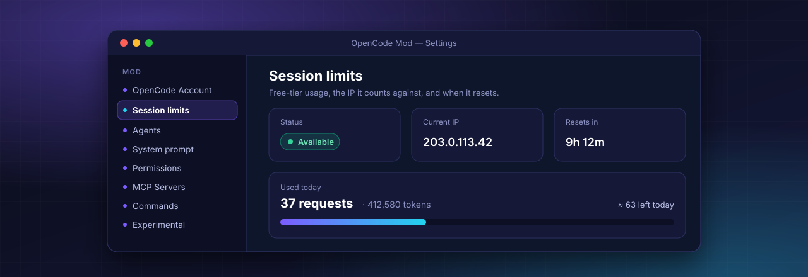

<div align="center">



# OpenCode Mod

**The power-user desktop app for the [OpenCode](https://github.com/anomalyco/opencode) AI coding agent.**<br>
Multiple accounts, free-tier tracking, editable system prompts, custom agents, MCP servers and hidden features, all in one Settings screen.

[](https://github.com/Subhashis360/opencode-mod/releases/latest)
[](https://github.com/Subhashis360/opencode-mod/releases)
[](https://github.com/Subhashis360/opencode-mod/stargazers)
[](../LICENSE)
[](#install)

### [⬇&nbsp;&nbsp;Download for Windows](https://github.com/Subhashis360/opencode-mod/releases/latest/download/opencode-mod-win-x64.exe)

[Features](#features) · [Install](#install) · [Compare](#opencode-vs-opencode-mod) · [FAQ](#faq) · [Build from source](#for-developers)

<sub>Unofficial community build. Installs <b>next to</b> OpenCode, never over it.</sub>

</div>

<br>

## Why OpenCode Mod

OpenCode is an excellent open-source AI coding agent, but its desktop app keeps a lot of power out of reach: agents, permissions, MCP servers and system prompts live in JSON files, accounts need the terminal, and dozens of engine features ship switched off.

OpenCode Mod puts all of it in **Settings → Mod**, with forms, templates and one-click presets, and keeps working with the same config, CLI and free models you already use.

- **Nothing to migrate.** It reads and writes the same OpenCode configuration as the official app and the `opencode` CLI.
- **Nothing to lose.** It installs as a separate app with its own folder, shortcuts and data, and updates itself from this repository.
- **Nothing hidden.** Every change is plain OpenCode config you can inspect, and the full source is right here.

## Features

<table>
<tr>
<td width="50%" valign="top">

### 👤 Multiple OpenCode accounts

Sign in from the app, stay signed in to several accounts and **switch between accounts and orgs** without signing out.

</td>
<td width="50%" valign="top">

### 📊 Free-tier session limits

See if the free tier is available, the **IP it is counted against**, time until reset, today's usage and an estimate of what is left.

</td>
</tr>
<tr>
<td valign="top">

### 🧠 System prompt editor

View the built-in prompt for each model, **compare it with GitHub's latest**, write your own per agent, and reset to default.

</td>
<td valign="top">

### 🤖 Custom agents

Create agents with their own model, prompt, temperature and tool limits. Templates include **Security Auditor**, **Code Reviewer**, **Debugger** and more.

</td>
</tr>
<tr>
<td valign="top">

### 🛡️ Permission presets

**Read-only audit**, **Safe**, **Balanced** or **Full auto** in one click, plus Allow / Ask / Deny for every tool.

</td>
<td valign="top">

### 🔌 MCP servers

Add local or remote **Model Context Protocol** servers with templates for Playwright, Context7, GitHub, Filesystem and Sequential Thinking.

</td>
</tr>
<tr>
<td valign="top">

### ⚡ Slash commands

Reusable `/commands` with `$ARGUMENTS`, shell output and file attachments: `/review`, `/audit`, `/tests`, `/commit` and more.

</td>
<td valign="top">

### 🧪 Experimental features

Turn on engine features OpenCode ships off: **code mode**, background subagents, the LSP tool, Exa or Parallel search, alpha models and more.

</td>
</tr>
<tr>
<td valign="top">

### ✏️ Editable custom providers

Edit an OpenAI-compatible provider's URL, models and headers in place instead of deleting and re-adding it.

</td>
<td valign="top">

### 🔄 Auto-updates, side by side

Runs next to the official app with its own shortcuts and data, and **updates itself** from GitHub Releases.

</td>
</tr>
</table>

## OpenCode vs OpenCode Mod

|                                         | OpenCode desktop       | **OpenCode Mod**             |
| --------------------------------------- | ---------------------- | ---------------------------- |
| Sign in to OpenCode accounts            | CLI only               | ✅ In the app, multi-account |
| Free-tier usage, IP and reset timer     | —                      | ✅                           |
| Edit system prompts per agent           | JSON files             | ✅ Editor + GitHub compare   |
| Create and edit agents                  | JSON / Markdown files  | ✅ Forms + templates         |
| Permission presets                      | JSON files             | ✅ One click                 |
| Manage MCP servers                      | JSON files             | ✅ Forms + templates         |
| Custom slash commands                   | JSON files             | ✅ Forms + templates         |
| Experimental engine features            | Environment variables  | ✅ Toggles                   |
| Edit a connected custom provider        | Delete and re-add      | ✅ Edit in place             |
| Settings stay open while you edit       | Close on outside click | ✅ Close button only         |
| Same config, CLI and free models        | ✅                     | ✅                           |
| Auto-updates                            | ✅                     | ✅                           |
| Runs side by side with the official app | —                      | ✅                           |

## Install

1. **[Download `opencode-mod-win-x64.exe`](https://github.com/Subhashis360/opencode-mod/releases/latest/download/opencode-mod-win-x64.exe)** from the latest release.
2. Run it and pick an install folder.
3. Open **OpenCode Mod** from the Start menu or desktop, then go to **Settings → Mod**.

**Requirements:** Windows 10 or 11 (64-bit). macOS and Linux can be built from source, but are not tested yet.

**Updates** are checked every 10 minutes and from **Settings → General → Check for updates**; the app asks before restarting to install one.

## A tour of Settings → Mod

| Tab                  | What you can do                                                                               |
| -------------------- | --------------------------------------------------------------------------------------------- |
| **OpenCode Account** | Add accounts with a sign-in code, switch account or org, sign out; see what your chats use    |
| **Session limits**   | Free-tier status, public IP, reset countdown, usage per model, 7-day history, estimated limit |
| **Agents**           | Create, edit, enable and delete agents; start from 7 templates                                |
| **System prompt**    | Per-agent prompts, the 9 built-in prompts, GitHub's latest versions, your own prompt library  |
| **Permissions**      | Four presets and per-tool Allow / Ask / Deny                                                  |
| **MCP Servers**      | Local and remote servers, environment variables, headers, timeouts, templates                 |
| **Commands**         | `/name` prompt templates with arguments, shell output and file attachments                    |
| **Experimental**     | Engine feature toggles, shell timeout and output token limit (applied after a restart)        |

## FAQ

<details>
<summary><b>Is this the official OpenCode app?</b></summary>

No. OpenCode Mod is an unofficial community build of the open-source [OpenCode](https://github.com/anomalyco/opencode) desktop app, which is MIT licensed. It is not affiliated with or endorsed by the OpenCode team.

</details>

<details>
<summary><b>Will it replace or break my OpenCode install?</b></summary>

No. It has its own install folder, app data, shortcuts, Windows app id and `opencode-mod://` links. Both apps can be installed and running at the same time.

</details>

<details>
<summary><b>Do my settings carry over?</b></summary>

Yes. Both apps and the `opencode` CLI share the configuration in `~/.config/opencode` and your OpenCode sign-ins, so agents, providers, MCP servers and commands appear in both.

</details>

<details>
<summary><b>How does the OpenCode free tier limit work?</b></summary>

OpenCode's gateway counts requests to its free models **per public IP address per UTC day** and resets at midnight UTC. It does not publish the exact limit. The **Session limits** tab shows your usage from this machine, the IP it is counted against, the reset time, and an estimate based on the last day you hit the limit. Other devices on the same network share the same limit.

</details>

<details>
<summary><b>Where are my API keys stored? Is it safe?</b></summary>

Exactly where OpenCode stores them, on your machine. The mod adds no telemetry or servers of its own; the only extra network calls are a public-IP lookup (api64.ipify.org) when you open Session limits and GitHub when you check for newer system prompts or updates. All source code is in this repository.

</details>

<details>
<summary><b>Why does a chat work when no account is signed in?</b></summary>

OpenCode's free models need no sign-in, and providers you connect use their own API keys or sign-ins. **Settings → Mod → OpenCode Account** lists exactly what your chats use.

</details>

<details>
<summary><b>Does it support macOS or Linux?</b></summary>

Releases are Windows-only for now. The app is cross-platform Electron, so it can be built from source on macOS and Linux, but those builds are not tested yet.

</details>

## For developers

<details>
<summary><b>Build from source</b></summary>

Requirements: [Bun](https://bun.sh) (the version in the root `package.json`), Git, Windows 10/11.

```bash
bun install --ignore-scripts
bun run --cwd packages/desktop package:mod
```

The installer is written to `packages/desktop/dist/`. `--ignore-scripts` skips a native module (`tree-sitter-powershell`) that needs Visual Studio build tools and is not used by the desktop app.

</details>

<details>
<summary><b>Release a new version</b></summary>

Needs the [GitHub CLI](https://cli.github.com) signed in with access to this repository.

1. Add a `## <upstream version>` section to [MOD-CHANGELOG.md](MOD-CHANGELOG.md) if there is none.
2. Run `bun run --cwd packages/desktop release:mod`.

It builds the installer and publishes the installer, its blockmap and `latest.yml` as a GitHub release, which installed copies pick up automatically.

Mod versions are `major.minor.(patch × 100 + revision)`: `1.18.2900` is upstream 1.18.29 with mod revision 0, the next mod-only release is `1.18.2901`, and upstream 1.18.30 becomes `1.18.3000`.

</details>

<details>
<summary><b>Repository history and staying in sync with OpenCode</b></summary>

GitHub shows the mod's own history: one commit importing upstream OpenCode, then the mod's commits. Upstream's full history and contributors stay in [anomalyco/opencode](https://github.com/anomalyco/opencode).

Development happens on a local `opencode-mod` branch that keeps upstream's full history, so OpenCode updates merge normally:

```bash
git remote add upstream https://github.com/anomalyco/opencode.git
git fetch upstream
git merge upstream/dev
bun script/mod-publish.ts
git push mod mod-public:main
```

`script/mod-publish.ts` copies new commits onto the published branch, turns each upstream merge into one "Sync with OpenCode x.y.z" commit, and refuses to update if the files would differ. The mod does not ship upstream's GitHub workflows, so keep any `.github/workflows/` conflict deleted with `git rm <file>`.

| Area                  | Files                                                                                                              |
| --------------------- | ------------------------------------------------------------------------------------------------------------------ |
| Mod settings tabs     | `packages/app/src/components/settings-v2/mod/`                                                                     |
| Mod strings           | `packages/app/src/i18n/mod.ts`                                                                                     |
| Mod server routes     | `packages/opencode/src/mod/`, `packages/opencode/src/server/routes/instance/httpapi/{groups,handlers}/global.ts`   |
| Provider editing      | `packages/app/src/components/dialog-custom-provider*.ts(x)`, `settings-providers.tsx`, `settings-v2/providers.tsx` |
| Separate app identity | `packages/desktop/electron-builder.config.ts`, `packages/desktop/src/main/{constants,index,migrate,mod-flags}.ts`  |
| Build and release     | `packages/desktop/scripts/{mod,utils,prebuild,predev}.ts`, `script/mod-publish.ts`                                 |

</details>

## Contributing

Bug reports, feature ideas and pull requests are welcome. Open an [issue](https://github.com/Subhashis360/opencode-mod/issues) describing what you would like to change. Changes to OpenCode itself are best sent upstream to [anomalyco/opencode](https://github.com/anomalyco/opencode).

## Credits and license

OpenCode Mod is built on [OpenCode](https://github.com/anomalyco/opencode), © opencode and its contributors, used under the [MIT License](../LICENSE). OpenCode Mod is not affiliated with or endorsed by the OpenCode team.

<div align="center">
<br>

**If OpenCode Mod saves you time, a ⭐ helps other developers find it.**

<sub>Keywords: OpenCode desktop app · AI coding agent · AI coding assistant for Windows · OpenCode GUI · MCP server manager · custom AI agents · system prompt editor · OpenCode free tier limit · OpenCode Zen · Claude, GPT, Gemini and local models</sub>

</div>
