<div align="center">


# OpenCode Mod

**A free AI coding agent for Windows that can also use your computer.**<br>
The OpenCode desktop app with everything unlocked: computer use, free models, a full mod menu, scheduled tasks, hooks and memory.

[](https://github.com/Subhashis360/opencode-mod/releases/latest/download/opencode-mod-win-x64.exe)
[](https://github.com/Subhashis360/opencode-mod/releases/latest)
[](https://github.com/Subhashis360/opencode-mod/releases)
[](https://github.com/Subhashis360/opencode-mod/stargazers)
[](../LICENSE)

[Computer use](#computer-use-for-0) · [Free models](#free-models-no-api-key) · [Mod menu](#the-mod-menu) · [Speed](#built-to-be-quick) · [Install](#install) · [FAQ](#faq)

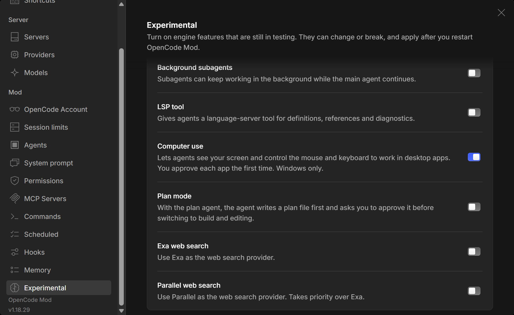

<sub>Real screenshots of OpenCode Mod, taken from a fresh install. Unofficial community build, installs <b>next to</b> OpenCode, never over it.</sub>

</div>

```text
$ opencode-mod
[ ok ] mod menu ........... 11 tabs, no JSON editing
[ ok ] computer use ....... sees and drives Windows apps
[ ok ] free models ........ no API key, no sign-in
[ ok ] scheduler .......... cron, tray, notifications
[ ok ] hooks + memory ..... loaded
ready.
```

## Computer use for $0


Letting an AI drive your desktop usually starts at **$20 a month**. Claude's computer use (Cowork, Claude in Chrome) needs a paid Claude plan, and ChatGPT's agent mode needs ChatGPT Plus. OpenCode Mod does it with the free models already built into OpenCode. No card, no API key, no account.

You tell the agent what you want, and it opens apps, reads windows, clicks, types and checks its own work. It's built for the boring stuff between your code and the rest of your PC: settings dialogs, installers, desktop tools that have no API.

|                    | **OpenCode Mod**                                        | Claude (Cowork / in Chrome) | ChatGPT agent                        |
| ------------------ | ------------------------------------------------------- | --------------------------- | ------------------------------------ |
| Cost to use it     | **$0** with OpenCode's free models                      | Paid plan, from $20/month   | Plus plan, $20/month                 |
| Which AI drives it | **Any:** free models, Claude, GPT, Gemini, local models | Claude only                 | OpenAI only                          |
| What it controls   | **Your own Windows apps**, on your PC                   | Your desktop or Chrome      | A virtual computer in OpenAI's cloud |
| Usage limit        | Free tier daily limit, none with your own key           | Plan limits                 | Monthly agent message cap            |
| Source code        | **Open, MIT**                                           | Closed                      | Closed                               |

<sub>Prices as of October 2026. Check <a href="https://claude.com/pricing">claude.com/pricing</a> and <a href="https://openai.com/chatgpt/pricing">openai.com/chatgpt/pricing</a> for current plans.</sub>

**How it works, briefly**

- **Reads windows as text first.** `read_window` pulls the buttons, fields and menus of a window through Windows UI Automation, so the model often doesn't need a screenshot at all. That's cheaper, faster, and it works with text-only free models.
- **Clicks without taking your mouse.** `click_element` presses buttons, ticks checkboxes and opens menus through accessibility, so your cursor stays where you left it. It only falls back to a real click when a control can't be pressed that way, and it tells you when it did.
- **Sees when it needs to.** Several free models in the picker read images, so screenshots and zoom work at no cost too.
- **Asks first.** You approve each app the first time the agent touches it. Terminals and IDEs only get plain clicks and scrolling, and the agent can't drive OpenCode Mod itself.

Turn it on in **Settings → Mod → Experimental → Computer use**. Windows only for now.

## Free models, no API key


OpenCode gives away a set of capable models through its own gateway. OpenCode Mod shows **every one of them** in the model picker, pulled live from OpenCode's catalog each time you open it, so new free models show up without an update.

Free usage is counted **per public IP per day** and resets at midnight UTC. The **Session limits** tab shows where you stand: whether the free tier is available right now, the IP you're counted against, time until reset and how much you've used.

<table>
<tr>
<td width="50%">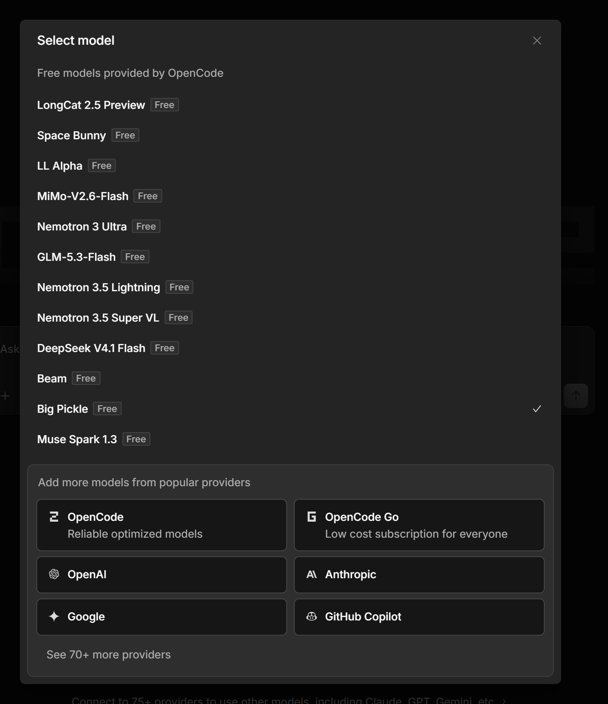</td>
<td width="50%">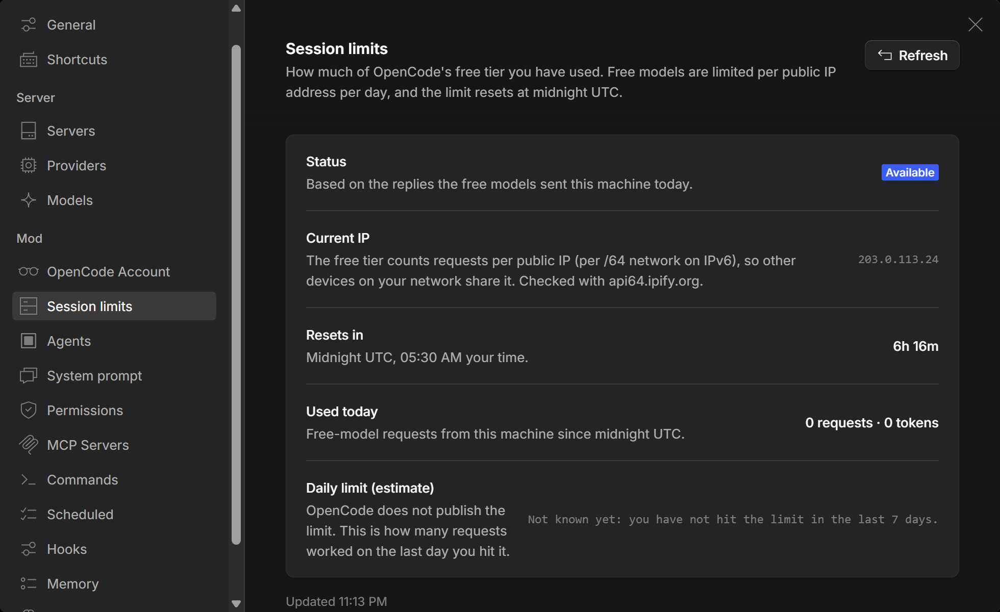</td>
</tr>
</table>

Want more? Connect Anthropic, OpenAI, Google, GitHub Copilot, OpenRouter or any of 75+ providers, or a local model. Everything below works with all of them.

## The Mod menu


OpenCode keeps most of its power in config files and environment variables. OpenCode Mod puts it in one place, **Settings → Mod**, with forms, templates and one-click presets. It writes the same config the `opencode` CLI reads, so nothing gets locked in.

| Tab                  | What it's for                                                                                                                                                                 |
| -------------------- | ----------------------------------------------------------------------------------------------------------------------------------------------------------------------------- |
| **OpenCode Account** | Sign in from the app, stay signed in to several accounts and switch accounts or orgs                                                                                          |
| **Session limits**   | Free-tier status, your public IP, reset countdown, usage per model and a 7-day history                                                                                        |
| **Agents**           | Your own agents with their own model, prompt and tool limits. Templates: Security Auditor, Bug Bounty Assistant, Code Reviewer, Debugger, Test Writer, Architect, Docs Writer |
| **System prompt**    | Read and edit the prompt each agent starts with, pull the newest built-in prompts from GitHub                                                                                 |
| **Permissions**      | Read-only audit, Safe, Balanced or Full auto in one click, plus Allow / Ask / Deny per tool                                                                                   |
| **MCP Servers**      | Add Model Context Protocol servers. Templates for Playwright, Context7, GitHub, Filesystem, Sequential Thinking                                                               |
| **Commands**         | Your own `/commands`: `/review`, `/audit`, `/tests`, `/explain`, `/commit`, `/fix` to start from                                                                              |
| **Scheduled**        | Prompts that run on a timer or cron, each in a fresh session, even with the window closed to the tray                                                                         |
| **Hooks**            | Shell commands on agent events. Block risky commands, format after edits, get pinged when it's done                                                                           |
| **Memory**           | Facts the agent saves about you and your projects; each new session starts with the relevant ones                                                                             |
| **Experimental**     | Switches for what upstream ships turned off: computer use, code mode, background subagents, plan mode, LSP tool, Exa and Parallel web search                                  |

<details>
<summary><b>See every tab</b></summary>
<br>

<table>
<tr>
<td width="50%">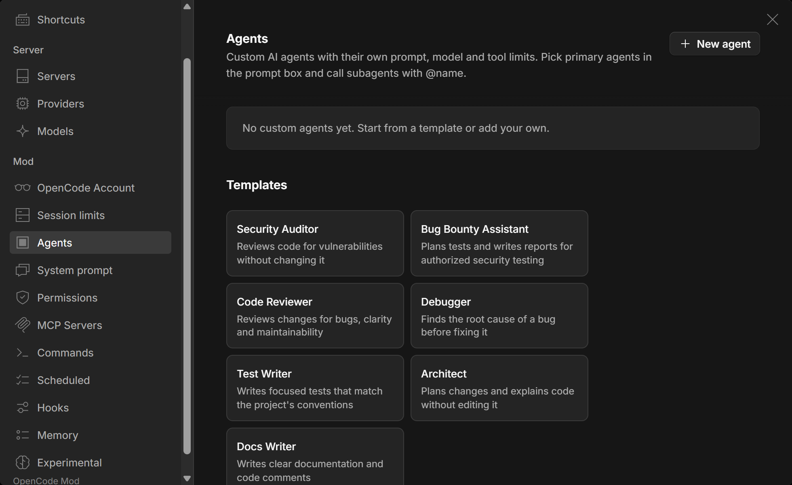</td>
<td width="50%">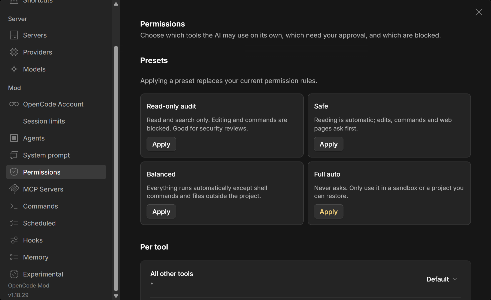</td>
</tr>
<tr>
<td>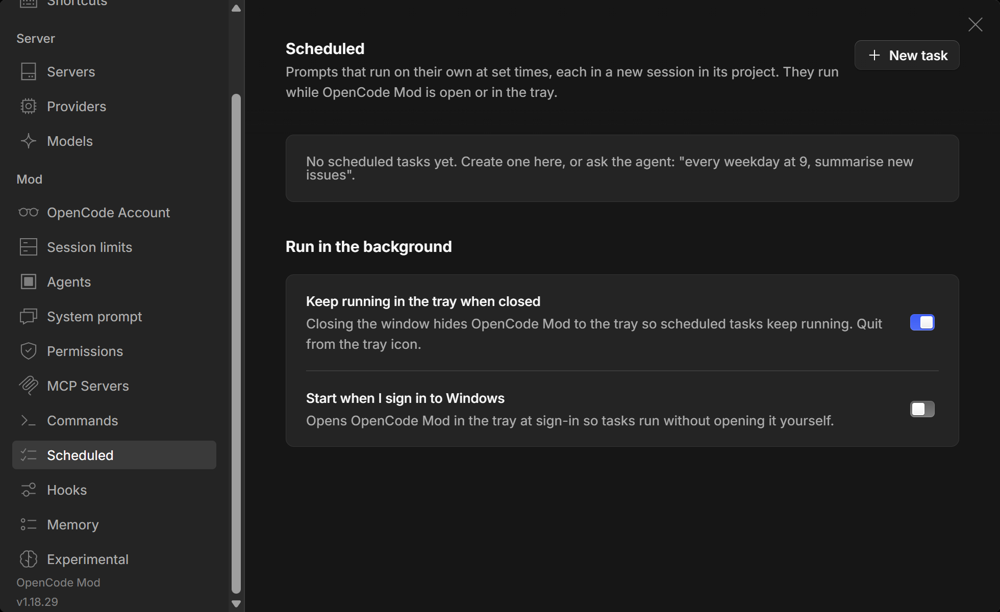</td>
<td>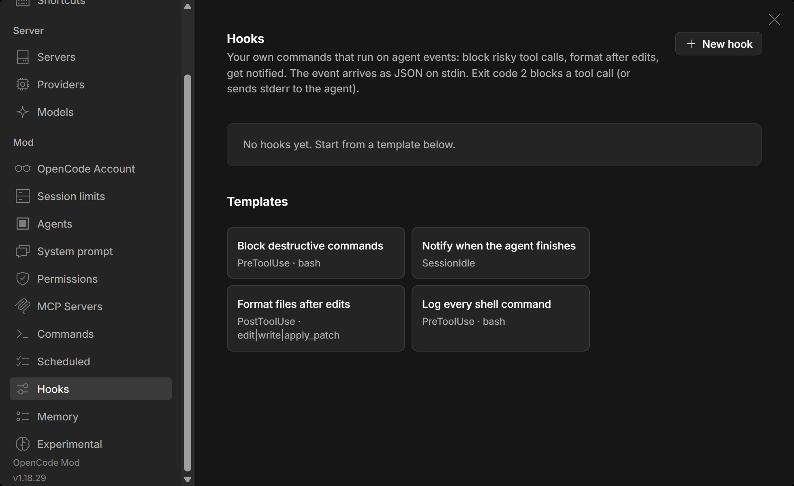</td>
</tr>
<tr>
<td>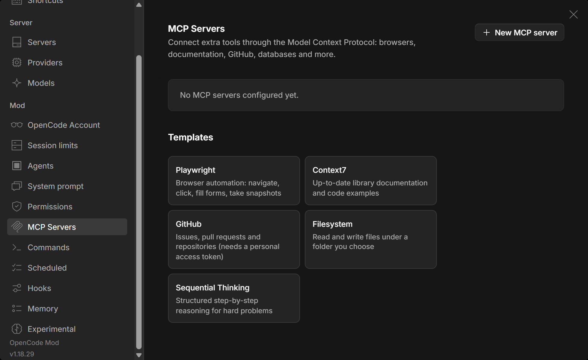</td>
<td>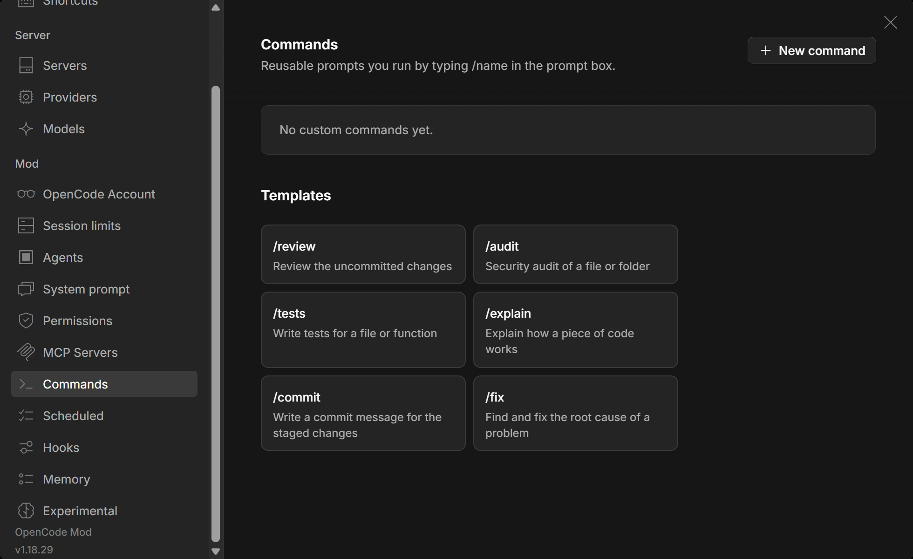</td>
</tr>
<tr>
<td>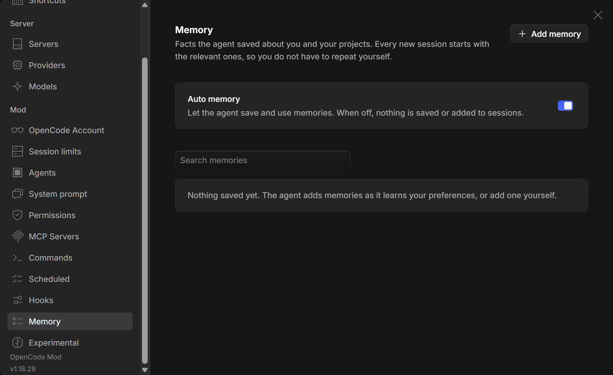</td>
<td>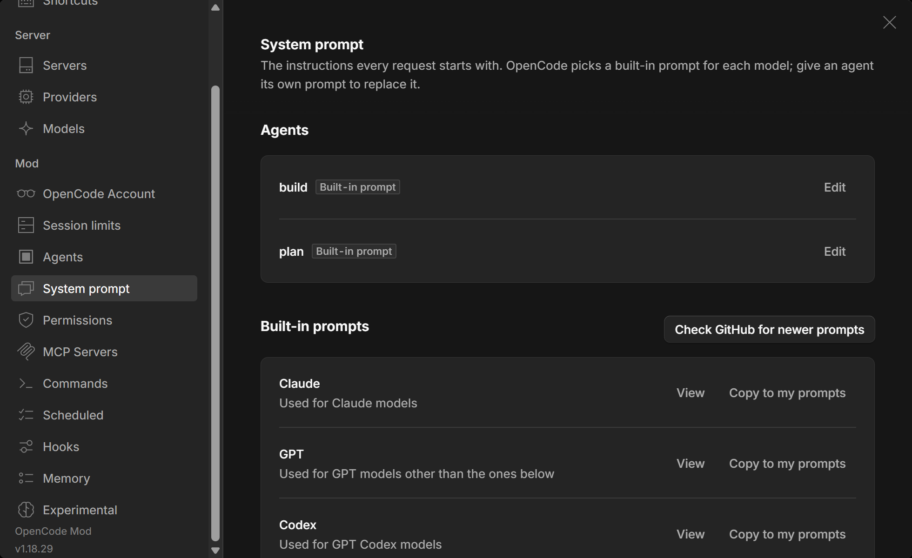</td>
</tr>
<tr>
<td>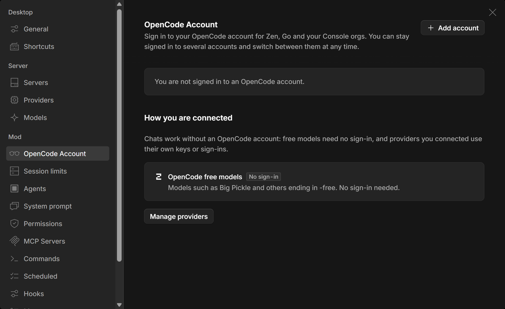</td>
<td></td>
</tr>
</table>

</details>

## Built to be quick


Most of the time an agent spends is waiting on the model, so the wins come from making fewer round trips.

- **Type while it works.** Messages you send mid-run reach the agent on its next step instead of waiting for the run to finish.
- **Long commands don't block.** Dev servers and builds run in the background and wake the agent when they finish or print what it's waiting for.
- **Computer use skips the busywork.** In our own sessions, about 60 of 222 computer-use calls were nothing but "take a screenshot" right after a click. That screenshot now comes back with the action. Typing went from 15.3 ms to 6.7 ms per character.
- **Code mode** (Experimental) lets the model chain several tools in one short script instead of one call at a time.

## OpenCode vs OpenCode Mod

|                                        | OpenCode desktop      | **OpenCode Mod**               |
| -------------------------------------- | --------------------- | ------------------------------ |
| Computer use (Windows apps)            | No                    | ✅ Free, per-app approval      |
| Every free model in the picker         | Some hidden           | ✅ All of them, refreshed live |
| Free-tier usage, IP and reset timer    | No                    | ✅                             |
| Scheduled prompts, tray, notifications | No                    | ✅                             |
| Hooks on agent events                  | Code plugins          | ✅ Shell commands, templates   |
| Memory across sessions                 | No                    | ✅                             |
| Sign in and switch OpenCode accounts   | CLI only              | ✅ In the app, several at once |
| Agents, permissions, MCP, commands     | JSON files            | ✅ Forms and templates         |
| Edit system prompts                    | Config files          | ✅ Editor, GitHub's latest     |
| Experimental engine features           | Environment variables | ✅ Switches                    |
| Same config, CLI and free models       | ✅                    | ✅                             |
| Auto-updates                           | ✅                    | ✅ From this repo              |

## Install


1. **[Download `opencode-mod-win-x64.exe`](https://github.com/Subhashis360/opencode-mod/releases/latest/download/opencode-mod-win-x64.exe)**
2. Run it and pick a folder.
3. Open **OpenCode Mod**, pick a free model and start. Everything else is under **Settings → Mod**.

Windows 10 or 11, 64-bit. It checks for updates every 10 minutes and asks before restarting. macOS and Linux build from source but aren't tested yet.

## FAQ

<details>
<summary><b>Is computer use really free?</b></summary>

Yes, with OpenCode's free models. They have a daily limit per public IP, which you can watch in Session limits. With your own Claude, OpenAI or Gemini key you pay that provider's normal API price, nothing to us.

</details>

<details>
<summary><b>Will the agent take over my mouse?</b></summary>

`click_element` and `read_window` work through Windows accessibility, so they leave your cursor alone. Clicking at a screen position, typing, scrolling and dragging do use the real mouse and keyboard, so let it finish those before you grab the mouse.

</details>

<details>
<summary><b>Is it safe to let an AI use my computer?</b></summary>

It asks before it touches each app for the first time, and you can deny. It can't type into terminals or IDEs (only plain clicks), can't control OpenCode Mod itself, and is told never to enter passwords or payment details. It's still an experimental feature: keep it away from anything you can't undo.

</details>

<details>
<summary><b>Is this the official OpenCode app?</b></summary>

No. It's an unofficial community build of the open-source <a href="https://github.com/anomalyco/opencode">OpenCode</a> desktop app (MIT). Not affiliated with or endorsed by the OpenCode team.

</details>

<details>
<summary><b>Will it break my OpenCode install?</b></summary>

No. It has its own install folder, app data, shortcuts and `opencode-mod://` links. Both can run at the same time, and both read the same `~/.config/opencode`, so your agents, providers and MCP servers show up in each.

</details>

<details>
<summary><b>Where do my API keys go?</b></summary>

Where OpenCode keeps them, on your machine. The mod adds no telemetry and no servers. The only extra network calls are a public-IP lookup (api64.ipify.org) when you open Session limits, and GitHub when you check for newer prompts or updates.

</details>

## For developers

<details>
<summary><b>Build from source</b></summary>

Needs [Bun](https://bun.sh) (version in the root `package.json`), Git and Windows 10/11.

```bash
bun install --ignore-scripts
bun run --cwd packages/desktop package:mod
```

The installer lands in `packages/desktop/dist/`. `--ignore-scripts` skips `tree-sitter-powershell`, a native module that needs Visual Studio build tools and isn't used by the desktop app.

</details>

<details>
<summary><b>Release a new version</b></summary>

Needs the [GitHub CLI](https://cli.github.com) signed in with access to this repo.

1. Add a `## <upstream version>` section to [MOD-CHANGELOG.md](MOD-CHANGELOG.md) if there isn't one.
2. Run `bun run --cwd packages/desktop release:mod`.

It builds the installer and publishes it with its blockmap and `latest.yml`, which installed copies pick up on their own. Versions are `major.minor.(patch × 100 + revision)`: `1.18.2900` is upstream 1.18.29, mod revision 0.

</details>

<details>
<summary><b>Repo layout and upstream sync</b></summary>

GitHub shows one commit importing upstream OpenCode, then the mod's own commits. Development happens on a local `opencode-mod` branch that keeps upstream's full history, and `script/mod-publish.ts` copies new commits onto the published branch.

| Area                  | Files                                                                                 |
| --------------------- | ------------------------------------------------------------------------------------- |
| Mod settings tabs     | `packages/app/src/components/settings-v2/mod/`                                        |
| Mod strings           | `packages/app/src/i18n/mod.ts`                                                        |
| Computer use          | `packages/opencode/src/tool/computer.ts`, `packages/opencode/src/computer/`           |
| Mod server routes     | `packages/opencode/src/mod/`, `packages/opencode/src/server/routes/instance/httpapi/` |
| Separate app identity | `packages/desktop/electron-builder.config.ts`, `packages/desktop/src/main/`           |
| Build and release     | `packages/desktop/scripts/{mod,utils,prebuild}.ts`, `script/mod-publish.ts`           |

</details>

## Contributing

Issues and pull requests are welcome. [Open an issue](https://github.com/Subhashis360/opencode-mod/issues) with what you'd like to change. Changes to OpenCode itself belong upstream at [anomalyco/opencode](https://github.com/anomalyco/opencode).

## Credits and license

Built on [OpenCode](https://github.com/anomalyco/opencode), © opencode and its contributors, under the [MIT License](../LICENSE). Animated emoji are Microsoft's [Fluent Emoji](https://github.com/microsoft/fluentui-emoji), animated set via [Animated Fluent Emojis](https://github.com/Tarikul-Islam-Anik/Animated-Fluent-Emojis). OpenCode Mod is not affiliated with or endorsed by the OpenCode team, Anthropic or OpenAI.

<div align="center">
<br>


**If it saved you $20 this month, a star helps other people find it.**

<sub>OpenCode Mod: free AI coding agent for Windows · free computer use AI agent · free alternative to Claude computer use and ChatGPT agent · OpenCode desktop GUI · OpenCode free models without API key · MCP server manager · custom AI agents · scheduled AI tasks · AI automation for Windows desktop apps</sub>

</div>
