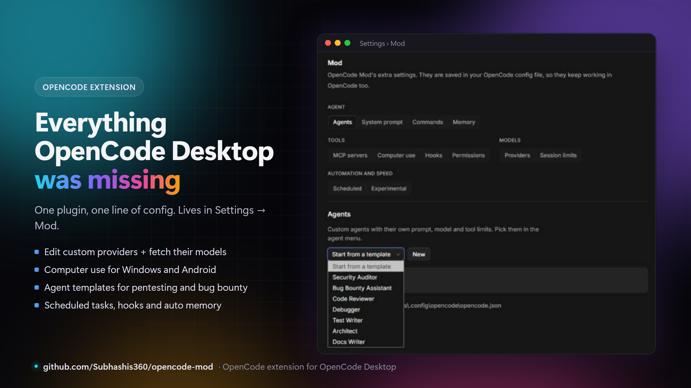
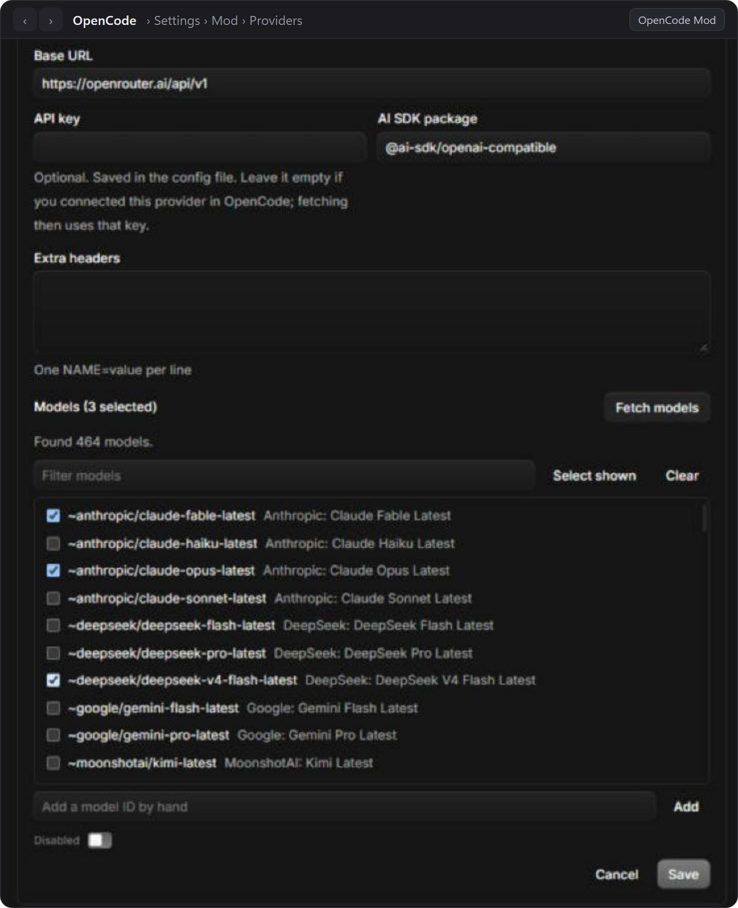
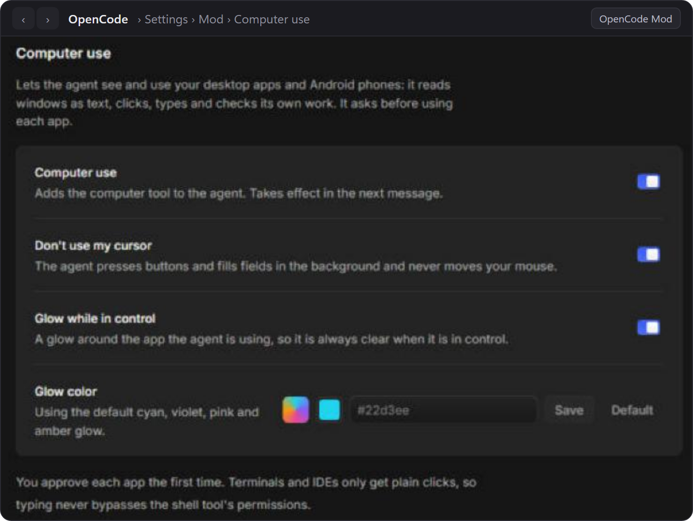
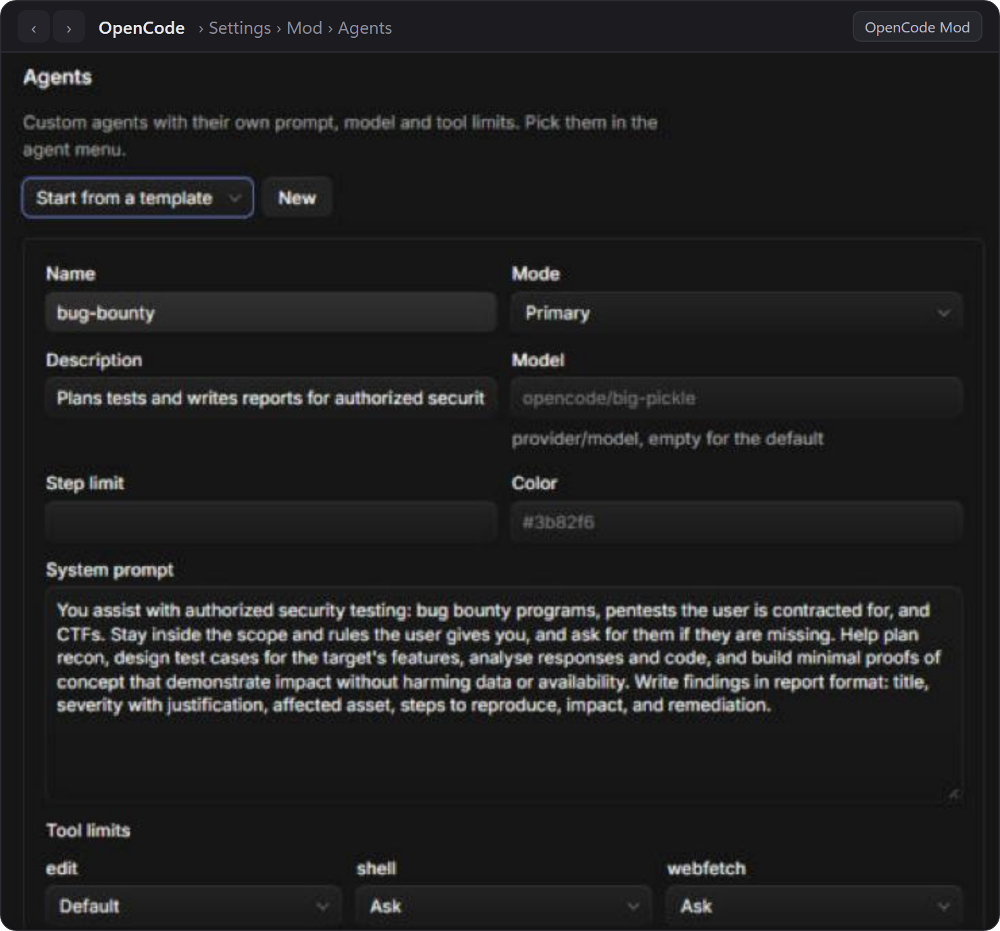
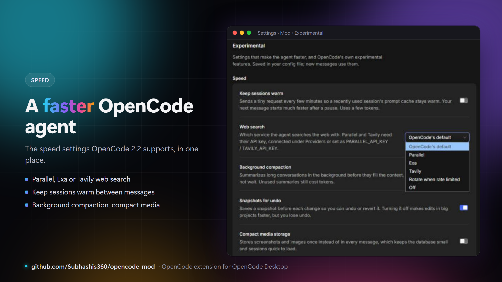

<div align="center">

**English** · [简体中文](docs/readme/README_zh.md) · [日本語](docs/readme/README_ja.md) · [한국어](docs/readme/README_ko.md) · [हिन्दी](docs/readme/README_hi.md)

# OpenCode Mod: the OpenCode Extension

### One plugin that gives OpenCode Desktop computer use, a provider editor, ready-made agents and automation.

**Your OpenCode agent can now use your computer, any model provider, and a schedule.**

[](https://opencode.ai)
[](https://opencode.ai/v2/docs/build/plugins/gui)
[](#computer-use-in-opencode)
[](https://github.com/Subhashis360/opencode-mod/stargazers)
[](LICENSE)

**[Install in one prompt](#ask-your-agent) · [Screenshots](#highlights) · [Report a bug](https://github.com/Subhashis360/opencode-mod/issues)**

[Quick start](#quick-start) · [How it works](#how-it-works) · [What it adds](#what-the-opencode-extension-adds) · [Highlights](#highlights) · [FAQ](#faq) · [Build from source](#build-from-source)

<code>git clone https://github.com/Subhashis360/opencode-mod.git</code>

</div>

> [!IMPORTANT]
> Get OpenCode Mod only from [Subhashis360/opencode-mod](https://github.com/Subhashis360/opencode-mod).
> It is an unofficial community extension, not made by the OpenCode team. The old standalone
> "OpenCode Mod" desktop app is discontinued: uninstall it and use this extension inside the official OpenCode app.

<div align="center">

<br />



<br /><br />

</div>

---

Want OpenCode to do more than edit code? Add this extension and its agent can open and control your desktop apps and Android phone. It can also use any OpenAI-compatible provider, with the model list fetched for you, and run prompts on a schedule while you're away.

OpenCode Mod is a plugin for the official **OpenCode Desktop** app. It adds a **Settings → Mod** page with twelve tabs, so agents, providers, MCP servers, permissions, hooks and memory are set up with forms instead of hand-edited JSON. Everything is saved in your normal OpenCode config, keeps working without the extension, and runs locally on your computer.

## Quick start

You need [OpenCode Desktop](https://opencode.ai) **2.2 or newer** and [Git](https://git-scm.com). Computer use needs Windows; everything else works on Windows, macOS and Linux. The built files ship in the repository, so there is nothing to compile.

### Ask your agent

Paste this into any coding agent that can run commands on your computer: OpenCode, Claude Code, Codex, Cursor, Gemini CLI and others.

```text
Install the OpenCode Mod extension for OpenCode Desktop from https://github.com/Subhashis360/opencode-mod

1. Check that git is installed. Clone the repository into a permanent folder in my home directory
   (for example ~/opencode-mod). If that folder already exists and is this repository, run `git pull` in it instead.
2. Open my global OpenCode config: ~/.config/opencode/opencode.json
   (on Windows: C:\Users\<me>\.config\opencode\opencode.json). Create the file with {} if it does not exist.
3. Add the absolute path of the cloned folder, written with forward slashes, to the "plugins" array
   (create the array if it is missing). Keep every other setting and every existing plugin exactly as it is,
   keep the file valid JSON/JSONC, and do not add the path twice.
4. Do not change anything else. Do not run npm install: the built files are already in the repository.
5. Show me the "plugins" line you wrote, then tell me to restart OpenCode Desktop (2.2 or newer)
   and open Settings → Mod, or press Ctrl+Shift+P and type "Mod".
```

### Install by hand

```bash
git clone https://github.com/Subhashis360/opencode-mod.git
```

Add the cloned folder to `plugins` in your **global** OpenCode config, `~/.config/opencode/opencode.json` (on Windows `C:\Users\<you>\.config\opencode\opencode.json`):

```jsonc
{
  "$schema": "https://opencode.ai/config.json",
  "plugins": ["C:/Users/<you>/opencode-mod"]
}
```

Use forward slashes on Windows too, and keep any plugins you already have. Restart OpenCode Desktop and open **Settings → Mod**, or press `Ctrl+Shift+P` and type **Mod**.

### Update and uninstall

The extension updates itself: each time OpenCode starts it checks this repository and installs an update in the background, then asks for a restart. Turn that off, or check and update with one click, in Mod → Updates. `git pull` in the folder still works. To uninstall, remove the line from `plugins` and restart OpenCode. Your settings stay in your config and do nothing on their own.

## How it works

OpenCode Desktop 2.2 loads plugins listed in the global `opencode.json`. OpenCode Mod has two parts:

| Part | Runs in | What it does |
| --- | --- | --- |
| Server part (`dist/server.js`) | OpenCode's local server | Adds the `computer`, `schedule` and `memory` tools, the hooks, the screenshot clean-up, and the API the settings page calls |
| Desktop part (`dist/gui-experimental.cjs`) | OpenCode Desktop's windows and main process | Adds the **Settings → Mod** page and commands, the tray icon, and the runner that starts scheduled tasks |

You talk to your agent as usual. When it needs your desktop it calls the `computer` tool, asks you before touching each app, and works through Windows UI Automation and OCR before falling back to screenshots. Settings you change in **Mod** are written to your OpenCode config, so OpenCode and the agent pick them up on the next message.

## What the OpenCode extension adds

| Group | Tab | What you get |
| --- | --- | --- |
| **Agent** | Agents | Custom agents with their own prompt, model, color and tool limits, from templates such as **Security Auditor** and **Bug Bounty Assistant** |
| | System prompt | The exact prompt OpenCode gives each model, editable per agent, plus your own prompt library |
| | Commands | Custom slash commands with a prompt, agent and model (`/review`, `/audit`, `/tests`, `/fix` templates) |
| | Memory | Facts the agent saves about you and each project, added to every new session |
| **Tools** | MCP servers | Local or remote MCP servers with a form (Playwright, Context7, GitHub, Filesystem templates) |
| | Computer use | The agent sees and controls Windows apps and Android phones, with per-app approval |
| | Hooks | Your shell commands before or after tool calls, on prompts, on idle and on errors |
| | Permissions | Presets (Read-only audit, Safe, Balanced, Full auto) and per-tool allow / ask / deny |
| **Models** | Providers | **Edit custom providers and fetch their models** from the provider's API |
| | Session limits | Your free-model usage today and over the last week |
| **Automation and speed** | Scheduled | Prompts that run once, every N minutes, daily, weekly, monthly or on a cron, with notifications |
| | Experimental | **Parallel web search**, warm sessions, background compaction and other speed settings |

## Highlights

### Edit any provider and fetch its models



OpenCode's own Providers page can only rename or remove a provider. **Mod → Providers** (or **Edit custom providers** in the command palette) edits the base URL, API key, headers and AI SDK package of any OpenAI-compatible provider, and **fetches its model list** so you only tick the models you want. It has templates for OpenRouter, Ollama, LM Studio, NVIDIA NIM and Together. Fetching uses the key you typed or the one you already connected in OpenCode, and runs through OpenCode's local server, so the provider's CORS rules don't block it.

### Computer use in OpenCode



The agent opens apps, reads windows, clicks, types and checks its own work, on Windows and on Android phones over `adb`. It reads windows as numbered text first, which is faster and works with text-only models. With **Don't use my cursor** on, it presses buttons through accessibility while you keep using your mouse. A glow outlines the app it is using and disappears when the run ends. Screenshot files are deleted as soon as they are read, and older screenshots are dropped from the conversation so every step stays quick.

### Pentest and bug bounty agents in two clicks



**Security Auditor** reviews code for vulnerabilities without changing it and reports each finding with severity, location and fix. **Bug Bounty Assistant** is for authorized pentests, bug bounty programs and CTFs: it plans recon and test cases, builds minimal proofs of concept and writes findings in report format, asking before it runs commands. Code Reviewer, Debugger, Test Writer, Architect and Docs Writer cover everyday work.

### A faster agent: Parallel web search and warm sessions



**Mod → Experimental → Speed** brings together the settings that make OpenCode respond faster. You can switch web search to [Parallel](https://parallel.ai), Exa or Tavily, or rotate between them when one is rate limited. You can also keep recent sessions' prompt caches warm, summarize long chats in the background, turn off undo snapshots in big projects, store media compactly, and cap tool output.

## FAQ

<details>
<summary><strong>Is this an OpenCode extension or a separate app?</strong></summary>

An extension. It is a plugin package that OpenCode Desktop 2.2+ loads from your config, with a server part and a desktop part. The old standalone OpenCode Mod app is discontinued.

</details>

<details>
<summary><strong>How do I install a plugin in OpenCode Desktop?</strong></summary>

Add the plugin's folder or package to `plugins` in your global `opencode.json` and restart the app. See [Quick start](#quick-start) and OpenCode's [GUI plugin docs](https://opencode.ai/v2/docs/build/plugins/gui).

</details>

<details>
<summary><strong>Does OpenCode support computer use?</strong></summary>

Not by itself. This extension adds a `computer` tool for Windows apps and Android phones, with approval for each app.

</details>

<details>
<summary><strong>How do I edit a custom provider or fetch its models in OpenCode?</strong></summary>

Open **Settings → Mod → Providers**, press **Edit** on the provider, then **Fetch models**.

</details>

<details>
<summary><strong>Does it work with OpenCode's free models and my own API keys?</strong></summary>

Yes. It runs inside the official app, so your sign-in, OpenCode's free models and your own keys all work as usual.

</details>

<details>
<summary><strong>Does it send my data anywhere?</strong></summary>

No. The extension runs locally. Your agent's messages go to the model provider you chose, as they always do in OpenCode. Hooks only come from your global config folder, never from a project, so a cloned repository can't plant commands.

</details>

<details>
<summary><strong>What should I do if something breaks?</strong></summary>

Run `git pull` in the extension folder and restart OpenCode. If the problem stays, [open an issue](https://github.com/Subhashis360/opencode-mod/issues) with your OpenCode version, what you did and what you saw.

</details>

## Build from source

```bash
npm install --legacy-peer-deps
npm run build
```

`dist/server.js` is the server part and `dist/gui-experimental.cjs` the desktop part. Set `ELECTRON_SKIP_BINARY_DOWNLOAD=1` before `npm install` to skip Electron's download; only its types are used.

## License

[MIT](LICENSE). OpenCode is a trademark of its owners; this is an unofficial community extension.
